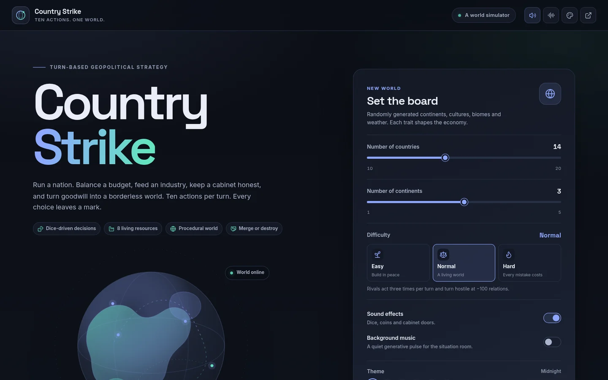
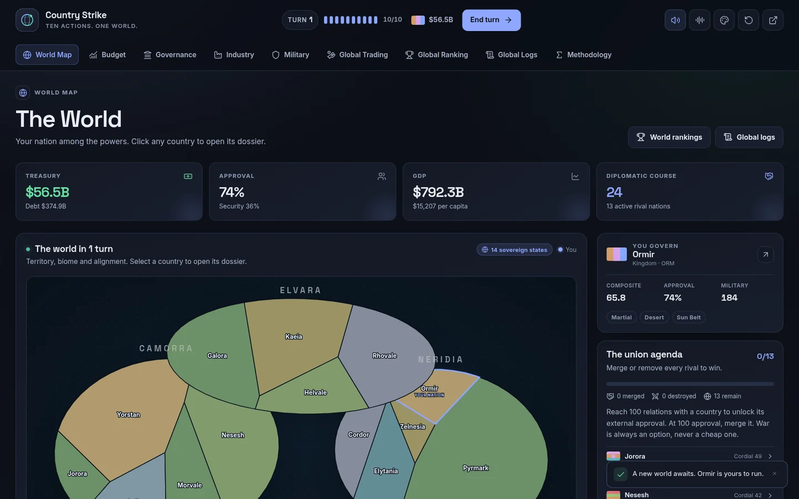
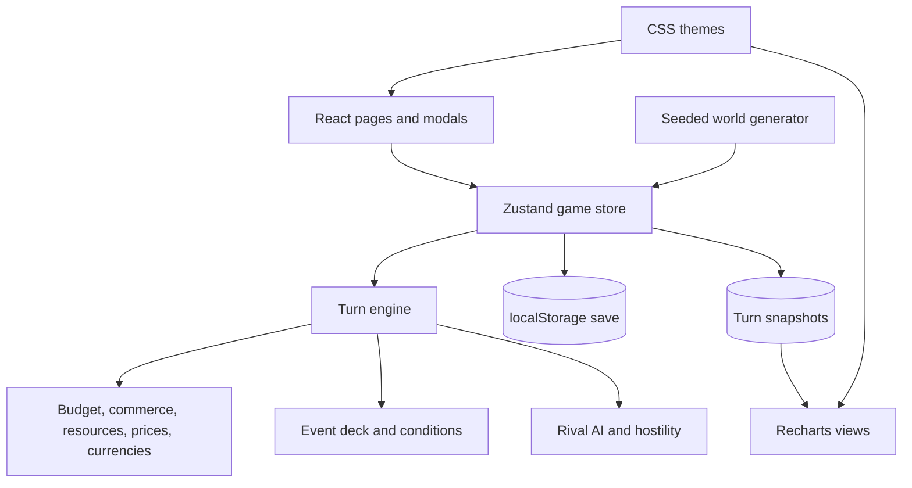

<p align="center">
  
</p>

<h1 align="center">Country Strike</h1>

<p align="center">
  <strong>Ten actions. One country. A world to win.</strong><br />
  A turn-based geopolitical strategy game that runs entirely in the browser.
</p>

<p align="center">
  <a href="https://banguDevClub.github.io/countrystrike/">Play the game</a> ·
  <a href="https://github.com/BanguDevClub/countrystrike">Source</a> ·
  <a href="https://github.com/BanguDevClub/countrystrike/issues">Issues</a>
</p>

<p align="center">
  
  
  
  
</p>

---

Country Strike drops you into the cabinet of a procedurally generated nation. Run a budget,
prospect and refine eight resources, bargain with rival governments, keep a cabinet of flawed
ministers in line, and decide whether the world will be united by diplomacy or by force.

The game is a local-first SPA. There is no backend, no account and no network state: a seeded
world and its history are persisted in `localStorage` after every action.

## The game

- **A living procedural world** — 10–20 nations across 1–5 continents, each with a culture,
  biome, weather pattern and two additional national traits. Every trait gives a buff, a debuff
  or a mixed modifier. Generate the world first, then inspect every economy on the map and
  choose the nation you want to lead.
- **Ten actions per turn** — every ministerial decision, industrial operation, recruitment,
  trade contract, diplomatic mission and war declaration is budgeted in actions.
- **A budget with teeth** — corporate and income taxes, import tariffs, resource royalties,
  six ministries, military upkeep, public services, debt service and trade contracts. The
  Laffer curve is modelled, not decorative. GDP growth is decomposed into drivers: debt,
  zero treasury, depleted reserves and shortages drag it down; resource output, stockpiles and
  surpluses lift it. The final rate normalises to a −50% to +50% swing in extreme crises.
- **A citizen checkout** — rice, eggs, chicken, beef, fuel, electricity, cars, housing,
  healthcare, education, transport and telecom are priced from industry supply, household
  demand and consumer imports. Every good can be taxed or subsidised; the basket feeds GDP,
  approval, depression, HDI and Gini.
- **Currencies and inflation** — every nation has its own currency, inflation rate and exchange
  regime. Inflation responds to deficits, shortages and cost pressure; exchange rates
  mean-revert toward relative purchasing-power parity with trade and risk premiums. Compare any
  two currencies and rank the world by currency strength.
- **Eight resource industries** — water, energy, agriculture, livestock, oil, metal, rare earth
  and uranium. Tiered d6 upgrades (1 fail, 2–5 improvements, 6 advancement) and single d10 research
  stimulus (1 fail, 2–9 bonuses on ext & ref, 10 +20% & advancement). Production, stockpiles and
  known reserves are valued against GDP on the Industry screen.
- **A composite world ranking** — treasure, debt, GDP, GDP per capita, PPP per capita,
  inflation, currency gap, average relations, external approval, population, military power,
  approval, HDI, Gini, violence and depression become a weighted 0–100 score with sortable
  columns and historical series charts.
- **Trade as foreign policy** — rival governments match surpluses to deficits through a world
  market pass; prices respond to aggregate deficits, the export volume that actually covers them
  and reserve scarcity. Manual contracts, 3-turn auto-deals, price posture and diplomatic
  consequences sit on top.
- **Events with teeth** — ministry betrayal events are gated by loyalty above 70, corruption
  events by corruption below 30. A nation above 1,000% debt/GDP faces a sovereign auction, and
  the core deck adds grey-market, emigration, regional-fund and digital-corridor choices.
- **World and economy modifiers** — resource prices, scarcity, market volatility, starting
  treasury, starting debt and starting industry can be tuned before generation.
- **Two routes to the end** — reach 100 relations, unlock external approval, campaign it to 100
  and merge a country; or destroy every rival by war. Win by leaving one state standing.
- **Six themes** — Midnight, Daylight and the four official Catppuccin flavours, with accessible
  text tokens and a theme-aware chart palette.

<p align="center">
  
</p>

## Quick start

Requires **Node.js 22.12+** (Node 24 recommended).

```bash
npm install
npm run dev
```

Open <http://localhost:5173/countrystrike/>.

The production build is served under the `/countrystrike/` base path:

```bash
npm run build
npm run preview
```

## Scripts

| Command                | What it does                                       |
| ---------------------- | -------------------------------------------------- |
| `npm run dev`          | Start the Vite development server                  |
| `npm run build`        | Type-check and build the production bundle         |
| `npm run preview`      | Preview the production build                       |
| `npm run lint`         | Run ESLint                                         |
| `npm run lint:fix`     | Apply safe ESLint fixes                            |
| `npm run format`       | Format with Prettier                               |
| `npm run format:check` | Verify formatting                                  |
| `npm run typecheck`    | Run the TypeScript project build                   |
| `npm run validate`     | Typecheck + lint + format check + production build |
| `npm run audit`        | Audit production/dev dependencies                  |
| `npm run audit:fix`    | Apply non-breaking audit fixes                     |
| `npm run outdated`     | List outdated packages                             |
| `npm run update`       | Update dependencies within their ranges            |
| `npm run clean`        | Remove build and Vite cache output                 |
| `npm run reinstall`    | Reinstall from a clean `node_modules`              |
| `npm run fresh`        | Reinstall and validate                             |

## Themes

| Theme     | Family         | Description                                       |
| --------- | -------------- | ------------------------------------------------- |
| Midnight  | Country Strike | A deep navy dark theme with blue and mint accents |
| Daylight  | Country Strike | A high-contrast light theme                       |
| Latte     | Catppuccin     | The official light Catppuccin palette             |
| Frappé    | Catppuccin     | The official mid-dark Catppuccin palette          |
| Macchiato | Catppuccin     | The official dark Catppuccin palette              |
| Mocha     | Catppuccin     | The official darkest Catppuccin palette           |

Themes are CSS-variable driven. Charts read the theme palette through the same tokens, so
switching themes updates the entire interface and every visualisation immediately.

## Architecture



```
src/
├── components/       Shared UI, layout, icon registry, flag renderer, modals
├── game/
│   ├── audio.ts      Procedural sound effects and master output bus
│   ├── music.ts      Three generative soundtracks and step scheduler
│   ├── color.ts      Hex mixing and shading for generated map palettes
│   ├── constants.ts  Resources, units, governments, ministries, traits, scoring
│   ├── engine.ts     Turn settlement, AI, history, event scheduling
│   ├── events.ts     Event deck, conditions and effect application
│   ├── format.ts     Money, quantity and percentage formatting
│   ├── mapVisuals.ts Map palettes, filters, route arcs and legend models
│   ├── rng.ts        Deterministic mulberry32 PRNG
│   ├── selectors.ts  Resource flows, budget, composite score and derived stats
│   ├── types.ts      Domain types
│   └── worldgen.ts   Seeded map, countries and initial state
├── hooks/            Small UI hooks
├── pages/            One route per game section
├── state/            Game store and persisted preferences
└── styles/           Theme tokens and responsive styles
```

## Design notes

### Deterministic worlds

Every random draw advances a stored 32-bit mulberry32 state. A reload never rerolls an
industrial check, an event or a price movement. The seed and current RNG state live with the
save.

### Resource flow

```
Extraction = level × capacity × (1 + extraction modifiers) × industry budget × (1 + research bonus)
Refinement = level × capacity × (1 + 0.55 × extraction modifiers) × industry budget × (1 + research bonus)
Production = min(Extraction, Refinement) × (1 + 0.15 × advances)
Consumption = population × civil factor + Σ(unit count × unit resource use)
Balance = production + imports − consumption − exports
Stock' = max(0, stock + balance)
Depletion = min(level_extraction, level_refinement) × capacity
Reserves' = max(0, reserves − depletion)
```

The full equations — including the budget, Laffer curve, market maker, consumer basket,
inflation, currency parity, military power, trade relations and composite score — are rendered
inside the game on the **Methodology** page with KaTeX.

### Commerce flow

```
Input available = production + resource imports − resource exports
Domestic supply = input × resource share ÷ input per unit × service capacity
Demand = population × demand per million
Effective demand = demand × clamp(1 − 0.55 × elasticity × rate, 0.55, 1.35)
Imports = effective demand × clamp((1 − domestic coverage) × 0.85, 0, category cap)
Coverage = (domestic supply + imports) ÷ effective demand
Price pressure = clamp((effective demand ÷ supply)^elasticity × (1 + 0.2 × import share), 0.4, 3)
Consumer price = base price × pressure × (1 + tax or subsidy rate)
Fiscal balance = levies − subsidies
Consumer trade = export credit − import bill
```

### Inflation and currency parity

```
Inflation target = base + monetised deficit + shortage and basket pressure
                   + demand-pull growth + FX pass-through − credibility
                   − stabilisation above 8% inflation
Fair rate' = fair rate × (1 + clamp(0.6 × (inflation − world inflation), −4%, +4%))
Market rate' = lerp(market rate, fair rate × (1 + risk + trade), regime speed)
```

Imports and exports affect the current account and the exchange rate, not the state budget:
households pay for consumer goods, while the treasury only collects levies or pays subsidies.

### Saving

The game state, current page and visual preferences are stored locally:

- `countrystrike-save` — the world, turn history and current screen
- `countrystrike-prefs` — theme, sound effects, music and soundtrack choice

Starting a new world replaces the save after an explicit confirmation.

## Quality checks

The project is developed against a narrow verification set:

- `npm run validate` covers type safety, linting, formatting and the production build.
- `npm audit` currently reports **0 vulnerabilities** (with a `minimatch` override for the
  development toolchain).
- TypeScript is held at **6.0.3** because `typescript-eslint` 8.x supports TypeScript `< 6.1`;
  TypeScript 7 is available but would break the current lint contract.
- UI verification was performed on desktop and mobile viewports, across the light and dark
  theme families, with interaction checks for the world map, budget, governance, industry,
  military, trade, ranking, logs and methodology screens.

## Deployment

The included **GitHub Pages** workflow builds and publishes the site on every push to `main`.
Enable Pages with **GitHub Actions** as the source. The Vite `base` is already set to
`/countrystrike/` to match the project URL:

<https://banguDevClub.github.io/countrystrike/>

## License

Released under the [MIT License](LICENSE).  
Built by [BanguDevClub](https://github.com/BanguDevClub).
